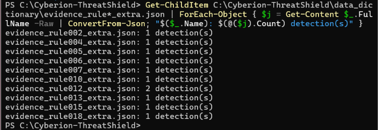

Cyberion ThreatShield – Final Report

Project: CDL-DET-V2 – Detection Engineering & Threat Hunting Engagement  
Author: Sneha Philip  
GitHub Repository: https://github.com/sonil-dot/Cyberion-ThreatShield

1. Executive Summary

This project focused on developing and testing security detection rules using Windows event logs. The main objective was to identify suspicious activities, investigate attack behaviour, and understand how detection rules can help a security team respond to potential threats.

A total of 21 Sigma detection rules were developed and mapped to the MITRE ATT&CK framework. These rules were tested using public Windows event log samples and attack recordings.

During the investigation, two notable attack behaviours were identified:

1. A legitimate Windows update utility was misused to execute a suspicious DLL (Incident INC-001).
2. A process injection technique was observed involving KeePass, a password manager (Incident INC-002). The logs confirmed the injection activity, although actual theft of the master password was not established.

Out of the 21 rules, 12 were successfully tested against real event log data using Chainsaw. Two additional correlation rules were checked manually using PowerShell. The remaining seven rules were created and passed syntax validation but could not be fully tested because suitable matching event samples were unavailable.

The project also identified areas where detection coverage could be improved, particularly phishing, command-and-control activity, data exfiltration, and remote desktop abuse.

Based on the findings, the main recommendations are to test the remaining rules with suitable datasets, improve coverage of the identified gaps, and use documented incident response playbooks when handling security alerts.

 2. Methodology

The project was completed using publicly available Windows event log samples and a combination of security analysis tools.

Data collection: Three primary datasets were used: a KeeThief KeePass sample, a WUauclt LOLBAS sample, and a WSMProvHost PowerShell Remoting sample. Nine additional public samples were also used for further rule testing. No live client data was involved.

Dataset source: EVTX-ATTACK-SAMPLES – https://github.com/sbousseaden/EVTX-ATTACK-SAMPLES

Detection rule development: Sigma was used to write the detection rules. The rules were checked using Sigma CLI version 3.1.0.

Rule testing: Chainsaw v2.17.1 was used to search the event logs against the Sigma rules, with the sigma-event-logs-all.yml mapping file.

Example command:

powershell
chainsaw.exe --no-banner hunt <evtx> -s <rule.yml> --mapping .\mappings\sigma-event-logs-all.yml

Event investigation: PowerShell Get-WinEvent was used to inspect individual Windows events and their XML EventData fields.

Timestamp handling: Event timestamps were recorded in UTC. PowerShell Get-WinEvent displays timestamps in local Indian Standard Time.

Version control: Git and GitHub were used to maintain the project files and track changes through commits.

Splunk conversion: Sigma CLI was used to generate Splunk search queries. These queries were not tested in a live Splunk environment.

3. Data Dictionary

The following Windows Sysmon event types and fields were important during the investigation.

3.1 Sysmon Event ID 1 – Process Creation

| Field | Purpose |

| Image / CommandLine | Identifies the program that was executed and its arguments. 
| ParentImage / ParentCommandLine | Shows which process started it. Useful for identifying suspicious parent-child relationships. 
| User, LogonId, IntegrityLevel | Provides information about the account and security context in which the process ran. 
| ProcessGuid / ParentProcessGuid | Helps connect related events and build a process timeline. 
| Hashes | Useful for identifying and researching suspicious files. 
| OriginalFileName | Helps identify executables that may have been renamed. 

3.2 Sysmon Event ID 8 – CreateRemoteThread

| Field | Purpose |

| SourceImage / SourceProcessId | Identifies the process initiating the remote thread. 
| TargetImage / TargetProcessId | Identifies the process receiving the thread. 
| StartAddress | Shows the memory address where the thread begins. 
| StartModule / StartFunction | Provides information about the module and function associated with the thread. 
| NewThreadId | Identifies the newly created thread. 

3.3 Sysmon Event ID 7 – Image Load

| Field | Purpose |

| Image / ProcessId | Identifies the process loading a module. 
| ImageLoaded | Shows the path of the DLL being loaded. 
| Signed / SignatureStatus | Provides information about the digital signature of the loaded file. 
| Hashes | Helps identify and research loaded DLLs. 
| ProcessGuid | Helps connect the DLL load event with other events from the same process. 

4. Detection Rule Library

A total of 21 Sigma rules were developed and stored in the sigma_rules directory. All rules passed the Sigma CLI syntax check.

The rules were tested using the available event log samples. Their results are documented in individual reports under data_dictionary.

Rule testing results

| Testing status | Rule numbers |

| Successfully validated using event log data | 001, 002, 004, 005, 006, 007, 010, 012, 013, 015, 018, 019 
| Created but not successfully validated | 003, 008, 009, 011, 014, 016, 017 
| Correlation rules checked manually | 020, 021 

Rule 001 identified two suspicious events involving WUauclt. Rule 018 was tested against the KeePass process injection sample. Rule 019 identified a child process launched by WSMProvHost, while the more restrictive Rule 016 did not match that particular sample.

Three correlation-style rules were included: 017, 020, and 021. Rules 020 and 021 were checked by reproducing their correlation logic in PowerShell because Chainsaw did not provide the required Sigma correlation testing. Rule 017 still requires further validation.

The individual test reports contain the rule objectives, test results, and observations.

5. MITRE ATT&CK Coverage

The detection rules were mapped to the MITRE ATT&CK framework to understand which attack techniques were covered by the project.

The coverage matrix is available at:

coverage_matrix/attack_coverage_matrix.csv

The matrix includes 22 techniques across 10 tactics, including Initial Access, Execution, Persistence, Privilege Escalation, Stealth, Defense Impairment, Credential Access, Lateral Movement, Command and Control, and Exfiltration.

The current coverage is:

- 12 techniques covered by tested rules.
- 5 techniques represented by rules that have not yet been validated.
- 5 techniques currently not covered by the detection library.

The ATT&CK technique identifiers and tags were based on the data available through Sigma CLI 3.1.0. Some identifiers may differ from older ATT&CK versions, so manual verification is still required. The five uncovered entries have not yet been rechecked against the same ATT&CK version.

6. Detection Rule Tuning

During testing, some rules were adjusted to understand how changes in detection conditions affect the results.

6.1 Rule 018 – KeePass Remote Thread

The KeePass investigation identified two CreateRemoteThread events, with different thread start information.

- Record 7070 started at ntdll.dll!DbgUiRemoteBreakin.
- Record 7071 started at an unbacked memory address, with no module or function information.

A narrower detection condition was tested using StartFunction containing DbgUiRemoteBreakin.

Chainsaw then returned one detection, corresponding to record 7070. Record 7071 was no longer detected.

Although the narrower condition reduced the number of alerts, it also missed the event involving the unbacked memory address. For this reason, the broader detection rule was retained.

6.2 Rules 016 and 019 – WSMProvHost Activity

Rule 016 was designed to identify command interpreters such as cmd.exe, powershell.exe, and pwsh.exe launched by wsmprovhost.exe.

However, it returned zero detections in the available WSMProvHost sample because the child process was HOSTNAME.EXE.

Rule 019 used a broader condition that looked for any child process launched by wsmprovhost.exe. It returned one detection.

The broader rule is more likely to identify different types of suspicious child processes, but it may also generate alerts during legitimate PowerShell remoting and administrative activity. An allow-list and additional tuning would therefore be needed.

6.3 Rule 001 – WUauclt

A tuned version of Rule 001 was tested by adding a requirement for UpdateDeploymentProvider in the parent command line.

The tuned rule retained both detections, giving the same result as the original rule: two detections out of two observed events.

No false positives were observed in this dataset. However, since benign activity was not tested, the actual false-positive rate cannot be determined.

More details are available in tuning/tuning_report.md.

7. Threat Hunts

Three threat hunts were conducted to investigate suspicious activity in the available event logs.

| Hunt | Technique investigated | Result 

| Hunt 001 – WUauclt unsigned DLL load | T1218 | Suspicious activity confirmed. 
| Hunt 002 – PowerShell injection into KeePass | T1055 / T1555.005 | Process injection confirmed, but credential theft was not proven by the logs. 
| Hunt 003 – Generic CreateRemoteThread activity | T1055 | Injection activity confirmed for the KeePass events. No other injection activity was identified in the reviewed data. 

The hunt documentation is available under threat_hunts, in the hunt_001 to hunt_003 files.

A separate correlation_001_winrm.txt file contains supporting notes.

Hunt 003 was also useful because it investigated a technique without relying on an existing dedicated detection rule.

8. Incident Case Reports

Two incident reports were prepared based on the suspicious activities identified during the investigation.

INC-001 – WUauclt Abuse

File: incident_reports/incident_001_case_report_wuauclt.md

This case involved the misuse of a legitimate Windows update utility to execute a suspicious DLL. The observed activity was classified as a True Positive.

INC-002 – KeePass Process Injection

File: incident_reports/incident_002_case_report_keepass.md

This case involved process injection activity targeting KeePass. The injection behaviour was confirmed from the event logs and classified as a True Positive. Actual credential theft was not independently established.

9. Incident Response Playbooks

Three incident response playbooks were prepared to provide guidance for handling different types of security incidents.

The playbooks cover:

1. Process injection.
2. Remote execution.
3. Credential compromise.

They are available in the playbooks directory as playbook_001 to playbook_003.

The purpose of these documents is to provide a consistent approach to investigating alerts, collecting evidence, and deciding on suitable response actions.

10. IOC Research

IOC research was carried out for the suspicious WUauclt and KeePass activities.

The research documents are:

- ioc_research/ioc_research_001_wuauclt.md
- ioc_research/ioc_research_002_keepass.md

Some of the important indicators observed during the investigation included:

- C:\ProgramData\Intel\helpa.dll – suspicious DLL path associated with the WUauclt activity.
- /UpdateDeploymentProvider – command-line argument observed during the WUauclt investigation.
- powershell.exe interacting with KeePass.exe through process injection activity.

These observations were used to support the investigation and the development of detection rules 001 and 018.

11. Limitations

There were a few limitations during the project that affected the extent of testing and validation.

- Only a small number of public Windows event log datasets were available for testing.
- The datasets mainly represented suspicious activity and did not provide a sufficient benign baseline for measuring false positives.
- Seven rules could not be validated against matching attack samples.
- Rule 017 correlation behaviour was not fully confirmed using a detection tool.
- The two additional correlation rules were checked manually using PowerShell rather than through a live SIEM.
- Splunk queries were generated but not executed in a live Splunk environment.
- Some MITRE ATT&CK technique identifiers require further verification.

These limitations mean that the detection rules should be treated as project-tested detection content rather than production-ready rules.

Appendix A – Project Repository

The project files, Sigma rules, datasets, test reports, investigation notes, and supporting documentation are maintained in the GitHub repository:

https://github.com/sonil-dot/Cyberion-ThreatShield

The Git commit history is available through the repository and records the changes made during development.

Appendix B – Evidence Screenshots

The following screenshots provide supporting evidence of the work carried out during the project.

Figure 1 – Rule 018 Chainsaw Output (1)

rule18_chainsaw.png)

Figure 2 – Tuning Test (1)

tuning_01.png)

Figure 3 – Rule 001 Chainsaw Output (2)

rule01_chainsaw.png)

Figure 4 – Rule 018 Chainsaw Output (2)

rule18_chainsaw.png)

Figure 5 – Rule 019 Chainsaw Output

rule19_chainsaw.png)

Figure 6 – Tuning Test (2)

tuning_01.png)

Figure 7 – Rule 001 Chainsaw Output (3)

rule01_chainsaw.png)

Figure 8 – Rule 018 Chainsaw Output (3)

rule18_chainsaw.png)

Figure 9 – MITRE ATT&CK Coverage Matrix

Figure 10 – Dataset Collection

Figure 11 – Project Deliverables

Figure 12 – WUauclt DLL Evidence

Figure 13 – GitHub Repository

Figure 14 – Project Folder Structure

Figure 15 – Rule 020 KeePass Correlation

Figure 16 – Rule 021 WUauclt Correlation

Figure 17 – Sigma Rule Tags

Figure 18 – Rule 001 Chainsaw Output

Figure 19 – Rule 016 No-Match Result

Figure 20 – Raw Sysmon Event ID 8

Figure 21 – Rule 019 Chainsaw Output

Figure 22 – Sigma CLI Validation

Figure 23 – Rule 018 Tuning

Additional Evidence – Validation of Rules 002, 004–007, 010, 012, 013, 015 and 018 using public EVTX samples

