# Cyberion ThreatShield - Final Report
Project CDL-DET-V2 | Detection Engineering & Threat Hunting Engagement
Author: YOUR NAME HERE | Repo: https://github.com/sonil-dot/Cyberion-ThreatShield

---

## 1. Executive Summary (non-technical)

**What we did.** We built a library of 21 detection rules that turn security logs into alerts, mapped them to the industry-standard MITRE ATT&CK framework, and tested them on real attack recordings.

**What we found.**
- Two attack behaviours were detected in real recordings and fully investigated:
  1. A trusted Windows update program was abused to run a hidden program (case INC-001).
  2. A tool injected itself into a password manager to steal the master key (case INC-002). If this were a real client, every stored password would need to be reset.
- Of 21 rules, **12 are proven against real data** (3 on the engagement datasets, 9 more on public EVTX-ATTACK-SAMPLES files) and 2 correlation rules were validated by manual count. The other 7 are written and syntactically valid but have not been tested on a matching recording, so we do not claim they work.

**Biggest risks (coverage gaps).** Phishing delivery, command-and-control traffic, data theft, and remote desktop abuse have no detection (matrix rows marked Not covered).

**Recommendations.**
1. Test the remaining 7 rules on matching attack samples before relying on them.
2. Add detections for the uncovered areas above.
3. Adopt the incident playbooks so response quality does not depend on who is on shift.

## 2. Methodology
- **Data:** public EVTX samples (EVTX-ATTACK-SAMPLES / Mordor-style datasets), 3 files in `datasets/`: KeeThief KeePass sample, wuauclt LOLBAS sample, WSMProvHost PowerShell-remoting sample. Nine further public samples were copied to datasets/extra/ for additional rule validation. No live client data was used. Source: EVTX-ATTACK-SAMPLES, https://github.com/sbousseaden/EVTX-ATTACK-SAMPLES (confirm this matches where the files were downloaded).
- **Rule authoring:** Sigma format; syntax validated with sigma-cli 3.1.0 (`sigma check sigma_rules`: 0 errors, 0 issues).
- **Rule testing:** Chainsaw v2.17.1 with `mappings/sigma-event-logs-all.yml`. Command pattern:
  `chainsaw.exe --no-banner hunt <evtx> -s <rule.yml> --mapping .\mappings\sigma-event-logs-all.yml`
- **Event inspection:** PowerShell Get-WinEvent, reading EventData from each event's XML.
- **Timestamps:** all UTC. (Get-WinEvent displays local IST.)
- **Version control:** Git/GitHub, commits after each work item.
- **Splunk conversion:** SPL queries were generated with sigma-cli but **not executed** in a live Splunk.

## 3. Data Dictionary
### 3.1 Sysmon Event ID 1 - Process Creation
| Field | Meaning for detection |
|---|---|
| Image / CommandLine | What ran and with which arguments; core of most rules |
| ParentImage / ParentCommandLine | Who launched it; reveals LOLBin abuse (wuauclt parent) |
| User, LogonId, IntegrityLevel | Whose context; Medium vs High shows elevation |
| ProcessGuid / ParentProcessGuid | Stable IDs to link events into a timeline |
| Hashes | IOC lookups |
| OriginalFileName | Detects renamed binaries |

### 3.2 Sysmon Event ID 8 - CreateRemoteThread
| Field | Meaning for detection |
|---|---|
| SourceImage / SourceProcessId | The injector |
| TargetImage / TargetProcessId | The victim process |
| StartAddress | Where the thread begins |
| StartModule / StartFunction | Empty values suggest unbacked (injected) code |
| NewThreadId | Distinguishes multiple threads |

### 3.3 Sysmon Event ID 7 - Image Load
| Field | Meaning for detection |
|---|---|
| Image / ProcessId | The process that loaded the module |
| ImageLoaded | Path of the DLL; unusual folders (ProgramData, Temp) are suspicious |
| Signed / SignatureStatus | Unsigned DLLs inside signed system binaries indicate proxy execution |
| Hashes | IOC lookup and DLL identification |
| ProcessGuid | Links the load to later events from the same process instance |

## 4. Detection Rule Library
21 rules in `sigma_rules/`, all pass `sigma check`. Results:

| Status | Rules |
|---|---|
| Validated on real data | 001, 002, 004, 005, 006, 007, 010, 012, 013, 015, 018 and 019 (see data_dictionary/rule_test_*.md), 019 (1 detection) |
| Written, not validated | 003, 008, 009, 011, 014, 016, 017 (no matching sample found, or Chainsaw cannot run the rule; 016 returned 0 detections on the WinRM sample) |
| Correlation rule, tool validation unconfirmed | 017 (Chainsaw may not support Sigma correlation) |

Per-rule detail: `data_dictionary/rule_test_*.md`. Severity and false-positive notes are in each rule file.

Correlation-style rules: 3 of the 3 required: 017 (not validated: it depends on rule 016, which had 0 detections on the sample), 020 and 021 (manually validated by replicating the logic in PowerShell, since Chainsaw does not run Sigma correlation rules).

## 5. ATT&CK Coverage
See `coverage_matrix/attack_coverage_matrix.csv`: 22 techniques across 10 tactics (Initial Access, Execution, Persistence, Privilege Escalation, Stealth, Defense Impairment, Credential Access, Lateral Movement, Command and Control, Exfiltration).
- Covered (tested): 12 | Written, not validated: 5 | Not covered: 5
- ATT&CK version note: sigma-cli 3.1.0 uses a newer ATT&CK release in which Defense Evasion is split into Stealth and Defense Impairment, and techniques such as T1562.001 are renumbered (T1685). Tags and IDs for rules 003, 010 and 011 follow the tool data. The 5 Not covered rows were not re-checked against that version.

## 6. Tuning Pass
**Rule 018 (KeePass remote thread).**
- Observed: the two real events differ. Record 7070 starts at ntdll.dll!DbgUiRemoteBreakin; record 7071 starts at an unbacked address with no module or function.
- Candidate tuning: add `StartFunction|contains: 'DbgUiRemoteBreakin'`.
- Result: Chainsaw returned 1 detection (record 7070). Record 7071 was not detected.
- Trade-off: fewer alerts but a false negative on the injected-code variant. Decision: keep the broader rule.

**Tuning pass 2 (rules 016 and 019).** Rule 016 (cmd, powershell or pwsh child of wsmprovhost.exe) gave 0 detections on the WSMProvHost sample because the child process was HOSTNAME.EXE. Rule 019 (any child of wsmprovhost.exe) gave 1 detection. Trade-off: rule 019 is noisier where PowerShell remoting is used for administration and will need an allow-list.

**Tuning pass 3 (rule 001).** The tuned variant, which requires UpdateDeploymentProvider in the parent command line, kept both detections (2 vs 2). No false positive was observed in this dataset, so the precision gain is by design and not measured on benign traffic. Full details: `tuning/tuning_report.md`.

## 7. Threat Hunts
| Hunt | Technique | Conclusion |
|---|---|---|
| 001 wuauclt unsigned DLL load | T1218 | Confirmed |
| 002 PowerShell injection into KeePass | T1055 / T1555.005 | Confirmed as injection; credential theft not proven by logs |
| 003 generic CreateRemoteThread | T1055 (no generic rule) | Confirmed for the KeePass pair only; no other injection found |

Files: threat_hunts/hunt_001..003. correlation_001_winrm.txt is a supporting note. Hunt 003 satisfies the requirement for a hunt on a technique without an existing rule.

## 8. Incident Case Reports
- INC-001: `incident_reports/incident_001_case_report_wuauclt.md` (True Positive)
- INC-002: `incident_reports/incident_002_case_report_keepass.md` (True Positive)

## 9. IR Playbooks
`playbooks/playbook_001..003`: process injection, remote execution, credential compromise.

## 10. IOC Research
`ioc_research/ioc_research_001_wuauclt.md`, `ioc_research_002_keepass.md`. Key IOCs from real evidence: `C:\ProgramData\Intel\helpa.dll` (path, wuauclt abuse); wuauclt command-line flag `/UpdateDeploymentProvider`; powershell.exe injecting threads into KeePass.exe. Operationalised via rules 001 and 018.

## 11. Limitations (disclosed honestly)
- 12 of 21 rules validated by tool on real telemetry (2 more by manual count); 7 remain untested.
- Three small public datasets, single host each; no benign baseline, so false-positive rates are unmeasured.
- Rule 017 correlation not confirmed by a tool.
- Splunk queries generated but never executed.
- Some ATT&CK IDs need manual verification.

## 12. Recommendations
1. Validate the remaining 7 rules (003, 008, 009, 011, 014, 016, 017) against matching samples.
2. Cover phishing, C2, exfiltration and RDP.
3. Run a benign-baseline test before deploying any rule at scale.
4. Roll out the playbooks to all shifts.

## Appendix
Repo structure, commit history (`git log --oneline`), Chainsaw outputs in `data_dictionary/`.

## Appendix B: Evidence Screenshots

**Figure 1: (1)rule18_chainsaw**

rule18_chainsaw.png)

**Figure 2: (1)tuning_01**

tuning_01.png)

**Figure 3: (2)rule01_chainsaw**

rule01_chainsaw.png)

**Figure 4: (2)rule18_chainsaw**

rule18_chainsaw.png)

**Figure 5: (2)rule19_chainsaw**

rule19_chainsaw.png)

**Figure 6: (2)tuning_01**

tuning_01.png)

**Figure 7: (3)rule01_chainsaw**

rule01_chainsaw.png)

**Figure 8: (3)rule18_chainsaw**

rule18_chainsaw.png)

**Figure 9: attack_coverage_matrixexcel**

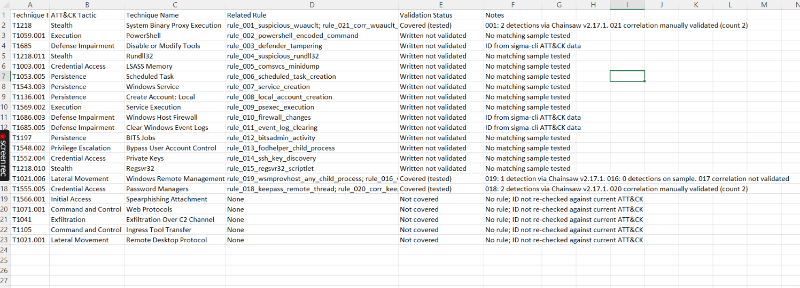

**Figure 10: Datasets**

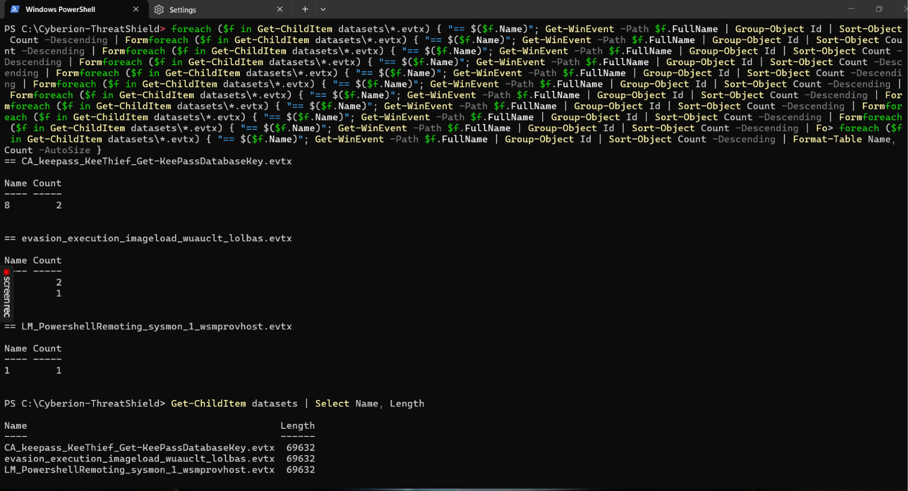

**Figure 11: Deliverables**

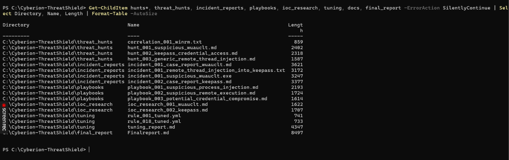

**Figure 12: eid7_helpa_dll**

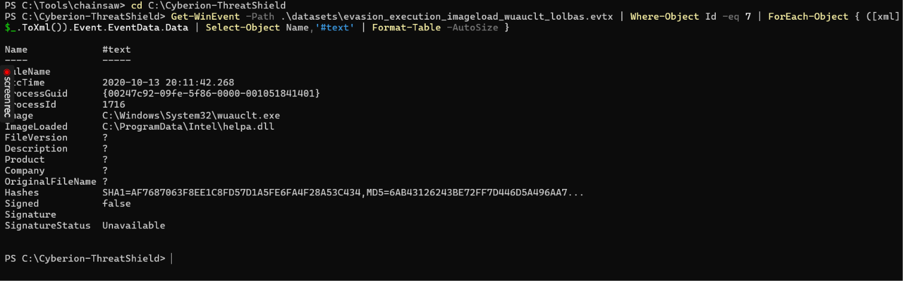

**Figure 13: github_repo**

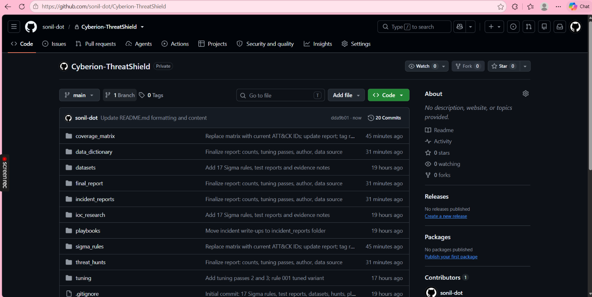

**Figure 14: repo_structure**

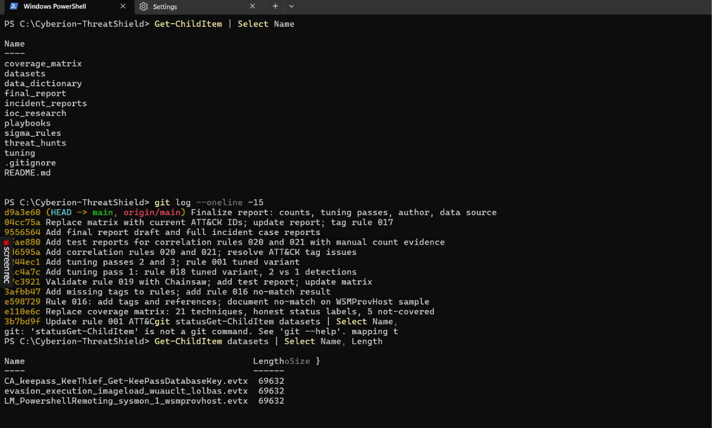

**Figure 15: rule_020_corr_keepass_multiple_threads**

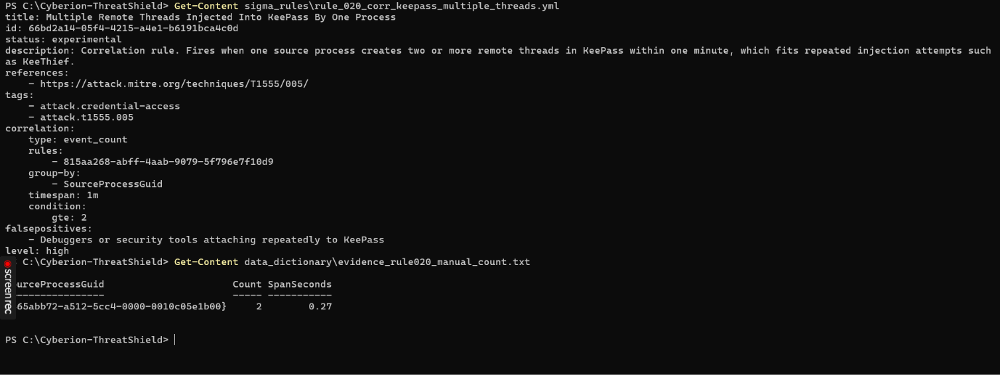

**Figure 16: rule_021_corr_wuauclt_multiple_cmd**

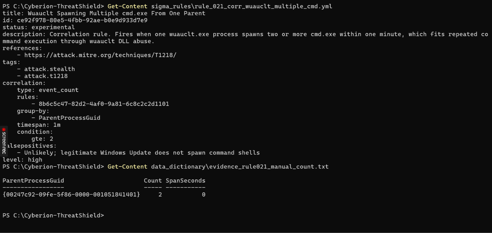

**Figure 17: rule_tags**

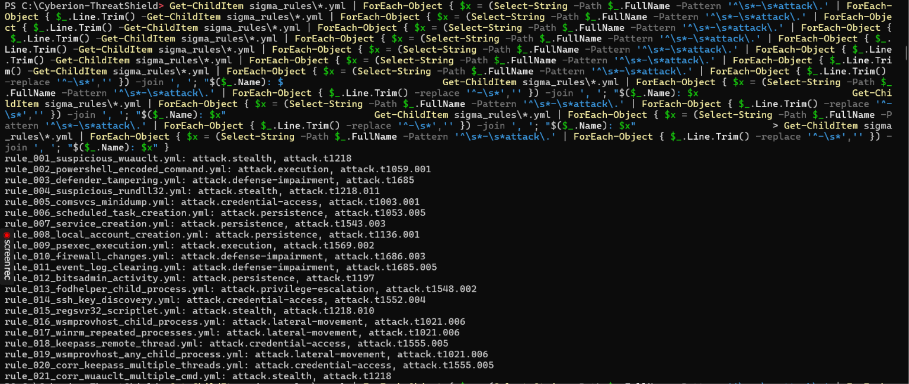

**Figure 18: rule01_chainsaw**

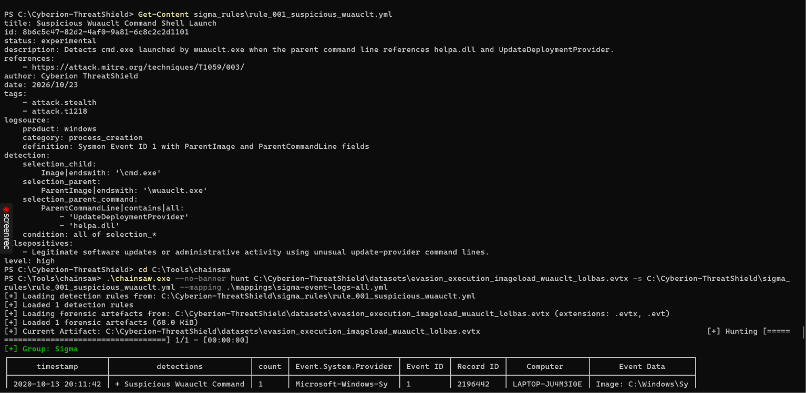

**Figure 19: rule16_no_match**

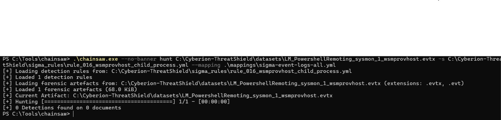

**Figure 20: rule18_raw_eid8**

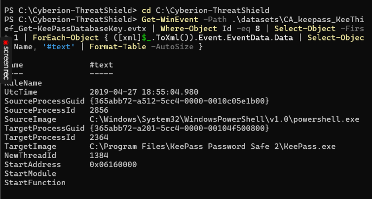

**Figure 21: rule19_chainsaw**

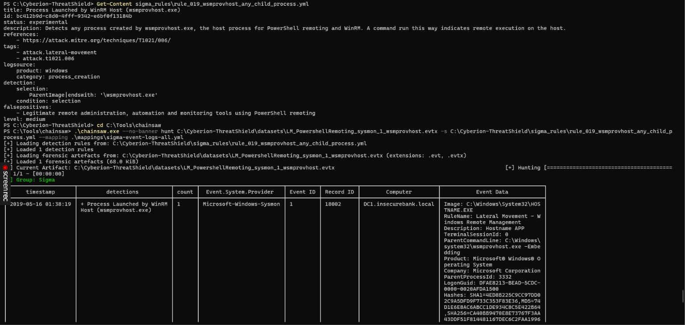

**Figure 22: sigma_check**

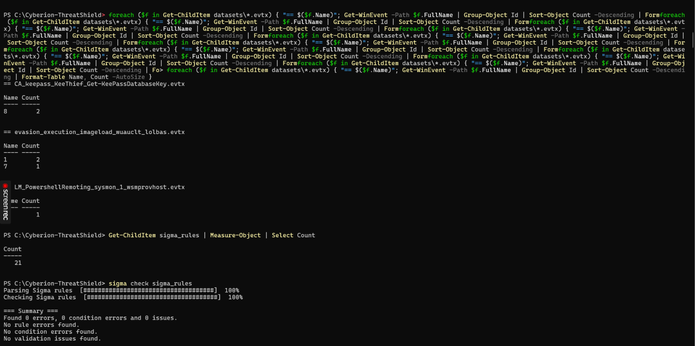

**Figure 23: tuning18**

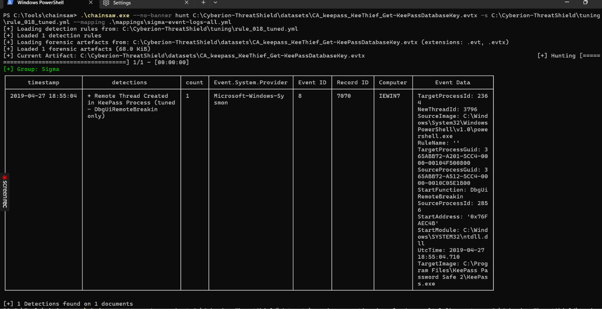

**Figure 19: Rules 002, 004-007, 010, 012, 013, 015 and 018 validated on public EVTX-ATTACK-SAMPLES files**

